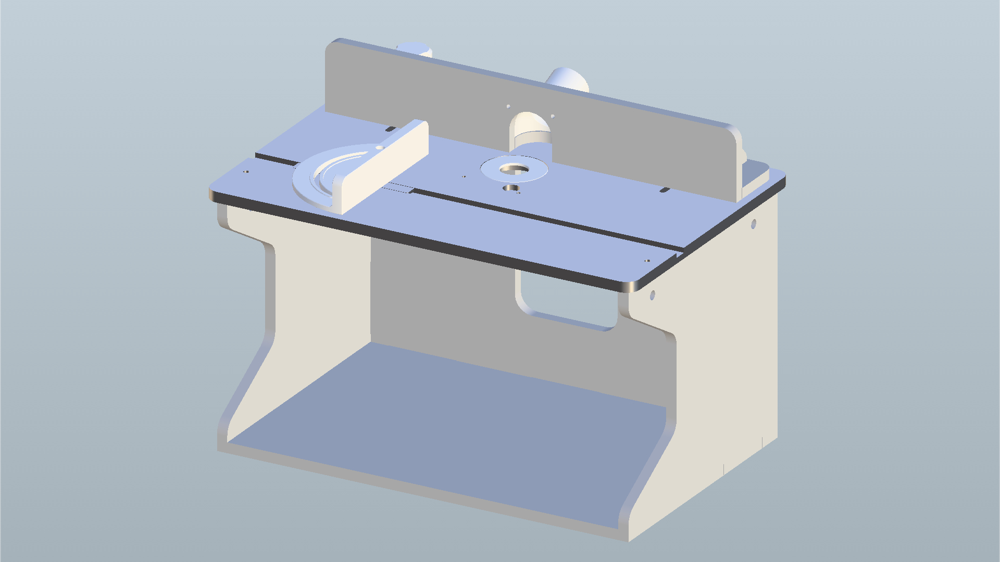

Maker Media GmbH

***

# Selbstbau-Frästisch

**Kleine Werkstücke mit der Oberfräse freihändig zu bearbeiten, ist fummelig und selten präzise. Mit einem selbstgebauten Frästisch lässt sich so eine Maschine aber mit wenigen Handgriffen in eine stationäre Fräse verwandeln.**

In diesem Repository findet ihr eine bemaßte Zeichnung sowie Materiallisten für die einzelnen Bestandteile (Table, Fence und AngleJig) des selbstgebauten Frästisch aus der Make 6/26. Je nachdem, welche Oberfräse eingebaut werden soll, muss man andere Schrauben dafür verwenden und die [3D-Datei](https://gmail681791.autodesk360.com/g/shares/SH90d2dQT28d5b602811b63e155741e3e614) anpassen.

**Material: Table**
- Siebdruckplatten 12 mm (Details siehe Zusammenstellungszeichnung Pos. 1 bis 4)
- Senkschrauben M6x45
- Quergewindemutter M6x12
- Holzschrauben 3.5x35 (Torx)
- Holzleim
- Gummifüsse
- Scheibenmagnete Dia 6x2 mm
- Schrauben zum Befestigen der Oberfräse

**Material: Fence**
- Siebdruckplatten 12mm (Details siehe Zusammenstellungszeichnung Pos. 5)
- Gewindestange M6 für die Klemmung des Fences
- Muttern M6
- Senkschrauben M4
- Muttern M4

**Material: AngleJig**
- Aluleiste 15x2 mm
- Zylinderschraube M5x12 mm

**Werkzeug:**
- Stichsäge
- Bohrmaschine
- Schleifmaschine
- Oberfräse
- 3D-Drucker und evtl. CNC-Fräse

Der vollständige Artikel zum Projekt steht in der **[Make-Ausgabe 6/26](https://www.heise.de/select/make/2026/6)**.
